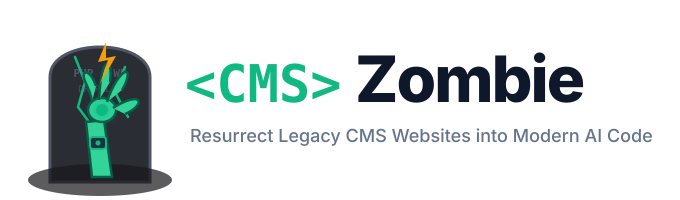

<p align="center">
  
</p>

# CMS Zombie 🧟‍♂️⚡

> **Resurrect dead, sluggish, vulnerable legacy CMS websites (WordPress, Drupal, Joomla) into high-performance, modern AI-developed applications.**

`cms-zombie` operates in **dual-mode**:
1. **A Standalone CLI Engine**: Runs completely offline to parse database dumps (`database.sql`), WXR exports, and media folders without requiring a live MySQL server.
2. **A First-Class Nuhut / Claude Plugin**: Equips AI coding agents with migration skills and commands (`/cms-zombie-extract`, `/cms-zombie-rebuild`) while automatically initializing [Nuhut](https://github.com/rezar-84/ai-sdlc-template) SDLC quality gates (`sdlc-content-seo`, `accessibility`, `ux-designer`).

---

## ⚡ Key Capabilities

- **Zero-DB SQL Parser**: Streams and extracts `wp_posts`, `wp_postmeta`, ACF fields, SEO titles, and taxonomies straight from raw `.sql` dumps in pure Python.
- **Shortcode & Gutenberg Sanitizer**: Strips visual page builder residue (Elementor, Divi, WPBakery / Visual Composer) and Gutenberg comments (`<!-- wp:... -->`) into clean semantic Markdown/MDX with frontmatter.
- **Automated 301 SEO Defense**: Guarantees zero loss of Google search rankings by computing complete 301 redirect mappings matching every historical permalink structure (`/%year%/%monthnum%/%postname%/`, `/?p=123`).
- **Media Optimization**: Copies `wp-content/uploads/` while skipping junk auto-generated thumbnail duplicates (`-150x150.jpg`, `-300x200.png`).
- **Modern Target Scaffolding**: Emits ready-to-run [Astro Content Collections](https://astro.build) with typed Zod schemas.
- **SDLC Quality Governance**: Automatically binds the newly scaffolded project to Nuhut's quality gates for WCAG 2.2 AA accessibility and URL verification.

---

## 🚀 Quick Start (CLI)

### 1. Installation

```bash
# Clone the repository
git clone https://github.com/rezar-84/cms-zombie.git
cd cms-zombie

# (Optional) Install in editable mode
pip install -e .
```

### 2. Extract Content & Media from a Backup

Extract all published posts and media into clean Markdown files:

```bash
python3 -m cms_zombie.cli extract \
  --sql /path/to/database.sql \
  --uploads /path/to/wp-content/uploads \
  --out ./extracted-content
```

Or extract from a native WordPress WXR export XML:

```bash
python3 -m cms_zombie.cli extract \
  --wxr /path/to/export.xml \
  --out ./extracted-content
```

### 3. One-Command Rebuild to Modern Astro

Rebuild the entire site into a modern Astro application and install Nuhut governance:

```bash
python3 -m cms_zombie.cli rebuild \
  --sql /path/to/database.sql \
  --uploads /path/to/wp-content/uploads \
  --target /path/to/my-new-site \
  --name "Resurrected Site"
```

Once completed, run the new modern application:

```bash
cd /path/to/my-new-site
npm install
npm run dev
```

---

## 🤖 Using as a Claude / Nuhut Plugin

`cms-zombie` includes native plugin definitions in `.claude-plugin/plugin.json`:

### Slash Commands Available to Agents
- `/cms-zombie-extract`: Triggers offline parsing of SQL dumps and media folders.
- `/cms-zombie-rebuild`: Directs the agent to scaffold the modern site, generate 301 redirect rules, and wire up Nuhut's SDLC checks.

### Agent Skill
Agents that navigate to this repository automatically receive the `cms-zombie-migrate` skill (`skills/cms-zombie-migrate/SKILL.md`), enforcing:
1. Non-destructive offline extraction.
2. Shortcode stripping without content loss.
3. 301 redirect parity checks via `sdlc-content-seo`.
4. Visual state completeness and WCAG 2.2 AA accessibility verification.

---

## 🏗️ Architecture

```
[WordPress / Drupal Backup]
   ├── database.sql (posts, meta, taxonomies)
   └── wp-content/uploads/ (raw media)
                │
                ▼
   [cms-zombie Ingestion Engine]
   ├── Zero-DB SQL Parser (Python streaming regex)
   ├── Builder Sanitizer (Elementor / Divi / Gutenberg)
   ├── Media Deduplicator (Filters thumbnails)
   └── SEO Matrix (Auto 301 Redirects)
                │
                ▼
   [Modern Astro Codebase]
   ├── src/content/config.ts (Typed Zod Schemas)
   ├── src/content/blog/*.md (Clean Markdown)
   ├── astro.config.mjs (Active 301 Redirects)
   └── public/assets/ (Original media)
                │
                ▼
   [Nuhut SDLC Governance Installed]
   ├── sdlc-content-seo (Verifies 301 redirects & metadata)
   └── sdlc-accessibility-audit (Verifies WCAG 2.2 AA)
```

---

## 🧪 Testing

Run the automated test suite:

```bash
python3 -m unittest discover -s tests
```

---

## 📄 License

MIT © Reza
